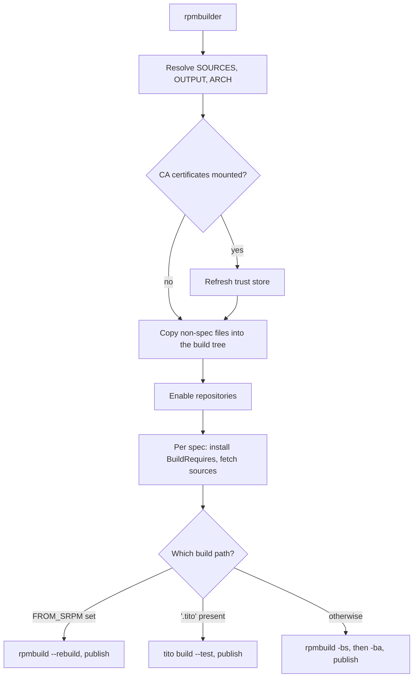

# Architecture

rpmbuilder is three artefacts in one repository:

| Artefact | File | Runs |
|---|---|---|
| Image definition | `Containerfile` | at image build time |
| Provisioning script | `bin/configure.sh` | once, during the image build |
| Entrypoint | `rpmbuilder.sh` | on every container run |

The `Makefile` drives the image build and the test suite, and the GitHub Actions under `.github/`
wrap the image for CI consumers.

## The layers

`Containerfile` takes `BASE_IMAGE` and `EXTRA_PACKAGES` as build arguments, layers the toolchain
onto the base distribution with `configure.sh`, and copies `rpmbuilder.sh` to
`/usr/bin/rpmbuilder`. It sets `SOURCES=/sources` and `OUTPUT=/output`, declares both as volumes, and
makes the entrypoint the image's `CMD`. All the distribution-specific work happens at build time, so
a published image is a finished, self-contained environment.

`configure.sh` picks a package manager, enables EPEL on an Enterprise Linux base, installs the
packaging toolchain, and creates the sources and output directories. It runs only during the image
build, so a consumer never sees it.

`rpmbuilder.sh` is the whole runtime interface. It resolves its settings from the environment,
refreshes the CA trust store when certificates are mounted, copies the build sources, enables the
requested repositories, resolves build dependencies, and dispatches to one of the three build paths.

## The dispatch

## Where state lives

| State | Location | Lifetime |
|---|---|---|
| Build tree, generated specs, binary RPMs | rpm's `%{_sourcedir}`, `%{_rpmdir}`, `%{_srcrpmdir}` | the container |
| Published artifacts | the `/output` mount | the host |
| Installed build dependencies | the container filesystem | the container |
| Tito provisioned at runtime | the container filesystem | the container |

Nothing outside the `/output` mount survives a run that uses `--rm`, which is what makes the default
invocation reproducible.

## Decisions worth knowing

**SRPM first, then the binary build.** `rpmbuild -bs` catches a malformed spec in seconds, before
the slow compile starts, and it produces the artifact a
[strict two-stage build](../usage/two-stage-tito.md) needs.

**Publish by package prefix.** A spec can define several packages from one build. On the spec path
the entrypoint asks `rpm --specfile` for the full `name-version-release` list and matches every
prefix against the built files, so each subpackage is published with the main package. The rebuild
path has no spec on disk and derives a single prefix from the SRPM itself.

**Tito provisioned at runtime.** Tito is not available as a package on every supported distribution,
so the entrypoint installs it when the image does not carry it, with a `pip` fallback. The cost is
paid only by projects that use it.

**One container run per action invocation.** The composite action is a single primitive, and a
multi-stage workflow composes it. That keeps the action predictable and leaves the workflow in
charge of the pipeline shape.

## Next

- [Testing](testing.md) for how these layers are exercised.
- [Contributing](contributing.md) for how to change them.
